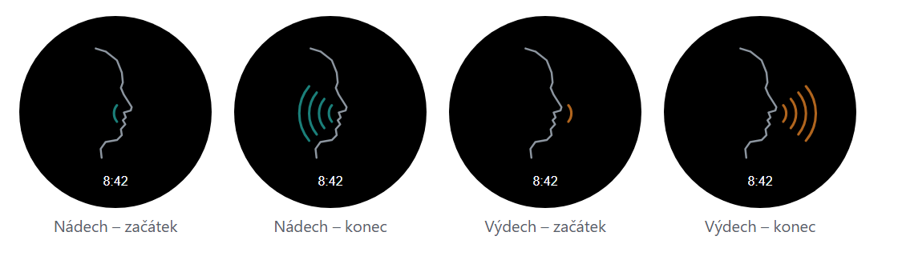

# Koherence – dechová meditace pro hodinky Garmin

Aplikace pro hodinky Garmin (Connect IQ), která vede koherenční dýchání jemnými vibracemi a každé cvičení uloží do Garmin Connect jako **meditaci** včetně tepu a dechové frekvence.



## Funkce
- Nádech a výdech zvlášť, 2–10 s (výchozí 5/5)
- Odpočet (5–60 min), nebo volné cvičení bez limitu
- Vibrace při každém přepnutí nádech/výdech: vypnuto / 15 / 30 / 40 ms
- Vedení celou dobu, nebo jen prvních 10 / 30 / 50 %, pak dýcháš sám – podle uložené dechové frekvence uvidíš, jestli jsi rytmus udržel
- Volitelná animace: soustředné kruhy, nebo profil tváře s obloučky (tyrkysová = nádech, jantarová = výdech)
- Pauza s menu Pokračovat / Uložit / Zrušit
- Název aktivity podle nastavení, např. „Koherence 5/5 · vedení 3 min"
- Hodinky si pamatují poslední nastavení

## Podporované hodinky
- Garmin Forerunner 165 Music – vyzkoušeno na skutečných hodinkách

Záznam jako meditace vyžaduje Connect IQ API 4.1.6 nebo novější.

## Zjištění z testování na hodinkách
- Forerunnery slijí vibrační vzory do jedné dlouhé vibrace, proto aplikace používá jen jednotlivé vibrace.
- Vibrace 15 ms je znatelná, ale meditaci neruší.
- Zvuky přehrávané aplikací nebyly na FR165 Music slyšet.

## Instalace (nahrání přes USB)
1. Připoj hodinky kabelem k počítači.
2. Zkopíruj `Koherence.prg` do `Internal Storage\GARMIN\Apps`.
3. Odpoj hodinky. Aplikaci si nainstalují a soubor ze složky odstraní.

## Sestavení
Potřeba: Connect IQ SDK 9.3.0 se soubory zařízení, Java 11+, vývojářský klíč (viz [dokumentace Garminu](https://developer.garmin.com/connect-iq/connect-iq-basics/getting-started)).

```powershell
.\build.ps1
```

Skript čeká přenosnou Javu v `.tools\jdk-*` a klíč v `.tools\developer_key.der` (obojí je mimo Git). Výsledek: `bin\Koherence.prg`.

## Jak vznikla
Aplikace vznikla za jeden den ve spolupráci s [Claude Code](https://claude.com/claude-code):

1. **Zadání:** společná diskuse, co má aplikace umět a co hodinky technicky dovolí.
2. **Zkušební verze:** ověření rizikových předpokladů dřív, než se stavěla celá aplikace (uloží se aktivita jako meditace? jak silná je vibrace? zaznamená se dech?).
3. **Testování v Claude Code:** sestavení, kontrola v simulátoru hodinek a ověření rozhraní v dokumentaci Garminu.
4. **Testování na hodinkách:** každou verzi jsem vyzkoušel při skutečné meditaci a podle toho jsme opravovali chyby a doplňovali vylepšení (jemnější vibrace, vedení jen na začátek, návrat do menu po zrušení, animace tváře).

Podrobné zadání: [docs/spec.md](docs/spec.md)
